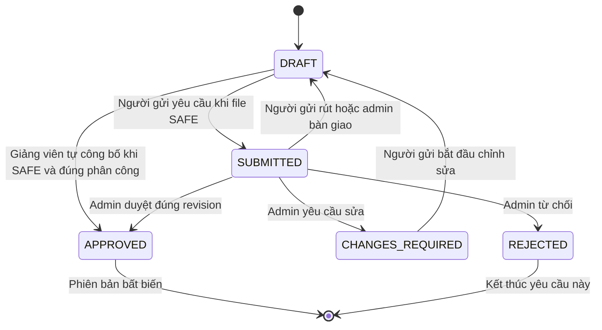

# HUCEScholar Quy tắc nghiệp vụ và luồng công bố

Khởi tạo09/10/2026; cập nhật quyết định sản phẩm14/10/2026, phiên bản1.3. Phục vụ MVP.

Quyết định14/10 thay A02: giảng viên upload tài liệu PDF không giới hạn nguồn HUCE, nguồn tham khảo tùy chọn, không bắt buộc khai báo căn cứ quyền và tự công bố khi file SAFE. Môn/phân công và ownership vẫn được kiểm tra. Luồng sinh viên không đổi. Proposal/Word và prototype cũ là tài liệu lịch sử, không ghi đè hiện vật đã bàn giao.

Quyết định17/10: giảng viên nhận PDF/DOCX trong cùng form. DOCX tạo PDF để đọc/tô/note, giữ Word gốc; scan nguồn, conversion và scan PDF độc lập trạng thái công bố/hiển thị. Chỉ công bố khi nguồn SAFE, conversion READY và PDF SAFE. Tải Word/PDF cùng phụ thuộc download_allowed; bản công bố và anchor cũ bất biến. Sinh viên vẫn PDF có kiểm duyệt. Xem [triển khai](implementation/2026-10-17-lecturer-pdf-docx-upload.md).

## 1. Cơ sở quyết định

Người đề xuất đã chốt các phương án A01–A06 sau khi rà soát proposal và use case. BR16–BR17 là lựa chọn thiết kế bổ sung để làm rõ quyền admin và bàn giao giảng viên. Đây là quyết định phạm vi dự án; chưa xác nhận sự hợp tác của nhà trường, API hoặc quyền sao chép toàn văn sách.

| Mã | Chính sách MVP đã chốt |
|---|---|
| A01 | Admin cấp hoặc xác minh tài khoản. Từ 22/10/2026 (AUTH-04), sinh viên và giảng viên tự đăng ký qua liên kết gửi email, tự chọn role, không cần admin duyệt; ADMIN chỉ do admin cấp. Giảng viên tự đăng ký chỉ đăng học liệu cho môn admin đã phân công. Chưa SSO. |
| A02 | Giảng viên tự công bố PDF SAFE của mình; không cần admin duyệt hoặc khai báo căn cứ quyền. Nguồn tham khảo tùy chọn. |
| A03 | Tài khoản đã xác minh xem được học liệu đã công bố theo quyền tài liệu; chưa giới hạn theo lớp hoặc môn đăng ký. |
| A04 | Sinh viên gửi tài liệu bổ sung có duyệt; không sửa giáo trình giảng viên. |
| A05 | Tải file gốc nếu được phép; ghi chú riêng, chưa xuất PDF kèm ghi chú hoặc offline. |
| A06 | Thư viện mini lưu metadata và liên kết nguồn được phép. Chỉ lưu toàn văn khi có căn cứ quyền sử dụng. |

## 2. Ma trận quyền

Mọi quyền đều yêu cầu tài khoản hoạt động và kiểm tra tại backend. ADMIN không mặc nhiên vượt quyền phân phối tài liệu. Người chưa đăng nhập chỉ vào giới thiệu, đăng nhập và khôi phục mật khẩu; không mở danh mục học liệu.

| Hành động | ADMIN | LECTURER | STUDENT |
|---|---|---|---|
| Tài khoản và role | Quản lý; giữ ít nhất một admin hoạt động | Không | Không |
| Danh mục môn và phân công | Quản lý | Xem phân công của mình | Xem danh mục được phép |
| Tạo và sửa giáo trình | Không biên soạn | Của mình và đúng phân công | Không |
| Tự công bố học liệu giảng viên | Không | Bản của mình, SAFE, đúng phân công/revision | Không |
| Gửi tài liệu bổ sung | Không | Dùng luồng học liệu giảng viên | Có; bài của mình |
| Duyệt hoặc yêu cầu sửa | Có; đúng revision | Không | Không |
| Ẩn hoặc khôi phục | Toàn tài liệu | Không | Không |
| Bàn giao người quản lý | Có theo BR17 | Không | Không |
| Đọc và tải | Theo quyền tài liệu | Theo quyền tài liệu | Theo quyền tài liệu |
| Xem trước bản chưa công bố | Theo quyền kiểm duyệt; file SAFE | Bản của mình, đúng phân công; file SAFE | Bài của mình; file SAFE |
| Ghi chú và thư viện cá nhân | Chỉ dữ liệu của mình | Chỉ dữ liệu của mình | Chỉ dữ liệu của mình |
| Xem ghi chú của người khác | Không | Không | Không |
| Quản lý sách hoặc báo cáo | Có | Gửi báo cáo theo quyền đọc | Gửi báo cáo theo quyền đọc |

Admin được biên tập danh mục sách, tài khoản, phân công và quyết định kiểm duyệt. Admin không sửa thay file hoặc metadata nội dung giáo trình; nếu có lỗi, yêu cầu người phụ trách chỉnh sửa rồi duyệt lại.

## 3. Ba trục trạng thái

| Trục | Trạng thái | Ý nghĩa |
|---|---|---|
| An toàn file | CHECKING, SAFE, FAILED | Kiểm tra kỹ thuật; FAILED không được đọc hoặc công bố |
| Xét công bố | DRAFT, SUBMITTED, CHANGES_REQUIRED, APPROVED, REJECTED | Theo từng phiên bản |
| Hiển thị | VISIBLE, HIDDEN | Theo toàn tài liệu, áp dụng mọi phiên bản |

Lượt đọc mới chỉ được cấp khi tài khoản hợp lệ, file SAFE, phiên bản APPROVED, tài liệu VISIBLE và quyền truy cập hiện hành cho phép. Tải xuống cần thêm downloadAllowed. Bản nháp không xuất hiện cho người học chỉ vì tài liệu mang VISIBLE.

APPROVED là trạng thái terminal dùng chung. publication_method=LECTURER_SELF ghi nhận giảng viên tự công bố, không tạo publication_requests và không giả quyết định admin. ADMIN_REVIEW mặc định cho dữ liệu cũ và duyệt sinh viên. Nguồn/căn cứ quyền trống hợp lệ với bản tự công bố, kể cả khi khôi phục tài liệu bị ẩn; vẫn kiểm tra hạn hiệu lực đã khai báo nếu có.

## 4. Chuyển trạng thái công bố

| Từ | Tác nhân và thao tác | Điều kiện và kết quả |
|---|---|---|
| Chưa có bản | Giảng viên hoặc sinh viên tạo | Tạo DRAFT; file vào CHECKING, sau đó SAFE hoặc FAILED |
| DRAFT | Giảng viên tự công bố | SAFE, tiêu đề/môn hợp lệ, đúng phân công; APPROVED và current nguyên tử, không qua yêu cầu duyệt |
| DRAFT | Sinh viên gửi công bố | SAFE, metadata và nguồn/quyền đầy đủ; chuyển SUBMITTED |
| SUBMITTED | Chủ bản rút | Kiểm tra revision; về DRAFT rồi mới được sửa |
| SUBMITTED | Admin yêu cầu sửa | Lý do bắt buộc; chuyển CHANGES_REQUIRED |
| CHANGES_REQUIRED | Chủ bản chỉnh sửa | Về DRAFT; thay file thì kiểm tra file lại |
| SUBMITTED | Admin từ chối | Lý do bắt buộc; REJECTED kết thúc yêu cầu này |
| SUBMITTED | Admin duyệt | Kiểm tra quyền, phân công, SAFE và revision; APPROVED và cập nhật bản hiện hành trong cùng giao dịch |
| APPROVED hoặc REJECTED | Chủ quản lý tạo bản mới | Tạo DRAFT mới; giữ nguyên bản cũ và lịch sử |
| SUBMITTED | Admin bàn giao giáo trình | Đổi chủ và rút về DRAFT nguyên tử; người nhận rà soát/gửi lại |

Lần công bố đầu có thể phục vụ người học khi đủ mọi điều kiện. Duyệt bản mới của tài liệu HIDDEN không tự mở lại tài liệu. Bản đang SUBMITTED không được sửa âm thầm; hai thao tác duyệt, rút hoặc bàn giao đồng thời chỉ một thao tác hợp lệ được lưu.

HIDDEN và chống xung đột cũng áp dụng tự công bố. Yêu cầu giảng viên SUBMITTED/CHANGES_REQUIRED cũ không tự thành công bố; chủ rút/mở lại thành DRAFT rồi dùng Công bố. Endpoint submit legacy còn tương thích, giao diện giảng viên mới dùng publish.

Phiên bản đã duyệt là bất biến. Bản mới không thay khóa ghi chú của bản cũ. Lịch sử phiên bản chỉ cấp quyền đọc với bản APPROVED còn an toàn, còn quyền sử dụng và tài liệu không bị ẩn; không lộ bản nháp hoặc bản bị từ chối.

## 5. Bàn giao giảng viên và ẩn tài liệu

BR16: ADMIN quản trị và duyệt nội dung, không trực tiếp biên soạn giáo trình. Quyền sửa danh mục sách theo UC22 được giữ riêng.

BR17: Bàn giao thực hiện trong UC06, chỉ áp dụng học liệu giảng viên. Admin chọn tài liệu, giảng viên nhận và nhập lý do. Người nhận phải hoạt động và được phân công tất cả môn gắn tài liệu. Backend kiểm tra revision, đổi chủ quản lý và rút mọi phiên bản SUBMITTED về DRAFT trong một giao dịch. Người nhận rà soát trước khi gửi lại.

Giữ nguyên tác giả, người gửi và quyết định trong lịch sử; không thay file đã duyệt hoặc liên kết ghi chú. Giảng viên cũ mất quyền quản lý sau bàn giao. Thu hồi phân công đơn thuần chặn sửa/gửi/duyệt mới nhưng không tự chuyển chủ, xóa file hay gỡ bản đã công bố. Chưa có người nhận phù hợp thì giữ nguyên dữ liệu và chặn công bố mới.

Ẩn/khôi phục trong MVP áp dụng toàn tài liệu. Admin nhập lý do, backend kiểm tra revision và ghi audit. Khi HIDDEN, mọi phiên bản ngừng cấp lượt đọc/tải mới. Ghi chú và mục lưu vẫn được giữ; giao diện báo tài liệu không khả dụng. URL ngắn hạn đã cấp có thể còn dùng đến hết hạn; file đã tải không bị thu hồi.

Khôi phục chỉ khi bản hiện hành APPROVED, SAFE, quyền hợp lệ và lý do gỡ đã giải quyết. Bản cũ vẫn được kiểm tra riêng; khôi phục không hợp thức hóa bản REJECTED hoặc FAILED. Không xóa file thật bằng thao tác ẩn.

## 6. Cơ sở cho ERD và wireframe

ERD cần tách tài liệu, phiên bản, file và lần xét duyệt; lưu chủ quản lý hiện tại riêng với tác giả/người gửi lịch sử. Ghi chú gắn người dùng, phiên bản và trang, có revision. Danh mục sách nguồn ngoài tách khỏi PDF nội bộ. Phân công giảng viên phải kiểm tra lại tại mỗi thao tác quản lý.

Wireframe cần thể hiện bản nháp, chờ kiểm tra, chờ duyệt, yêu cầu sửa, từ chối, tài liệu ẩn và lỗi lưu ghi chú. Luồng bàn giao hiển thị người nhận, các môn liên quan, bản chờ sẽ bị rút và xác nhận tác động. Reader hiển thị rõ phiên bản đang đọc, nguồn, quyền tải và trạng thái lưu.

Thứ tự tiếp theo: thiết kế ERD và wireframe, thử khả năng đọc/ghi chú trên bộ PDF được phép sử dụng, chốt stack theo năng lực nhóm rồi xây dựng API và backlog. Nhóm phát triển, ngân sách, lịch làm việc, môn thử nghiệm và nguồn nội dung cụ thể vẫn cần thông tin thực tế; đây không phải các chính sách đã được xác nhận trong lần chốt này.
